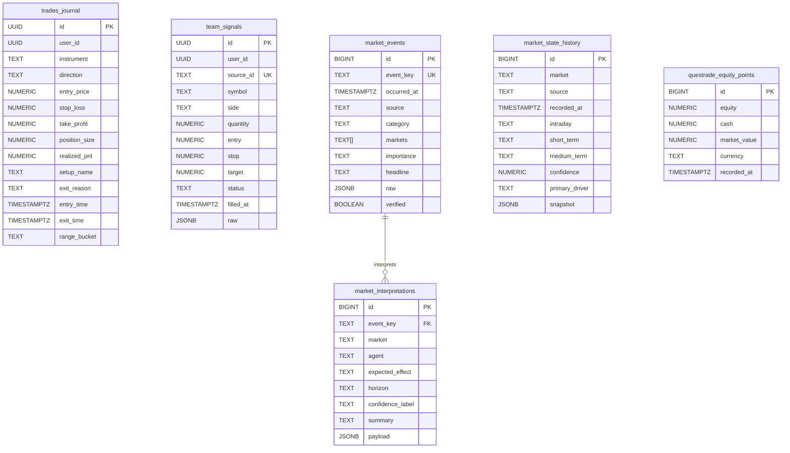

# 🏗️ 01. TradePulse System Architecture & Data Flow

> **Autonomous Market-Structure Analytics, Multi-Broker Execution, and AI Auditor Platform**  
> **Source Directory**: [`Trading/`](file:///c:/Users/shahb/myApplications/Trading)

---

## 1. Executive System Topology

TradePulse is a high-performance institutional trading workstation engineered to bridge institutional order flow analysis (CME Globex MDP 3.0), systematic auction market theory (Wyckoff & Dalton Market Profile), multi-broker execution accounting (Tradeify Futures, CMC Markets CFDs, Questrade Equities), and real-time AI auditing (Leo AI & Fundamental Intelligence Bus).

```mermaid
flowchart TD
    subgraph MarketData["1. Market Data Feeds & Normalization"]
        DB["Databento MDP 3.0<br/>(CME Globex Tick/1m)"]
        YF["Yahoo Finance API<br/>(Cross-Market Quotes)"]
        FH["Finnhub REST API<br/>(News & Calendar)"]
        QT["Questrade API<br/>(NYC Stock Book)"]
    end

    subgraph CoreEngine["2. Auction & Feature Calculation Engines"]
        VP["Volume Profile Engine<br/>(5D FRVP, Yesterday VAH/VAL/POC, ONP)"]
        VWAP["VWAP & AVWAP Engine<br/>(Session VWAP ±1σ/±2σ, 5M AVWAP ±3σ)"]
        DALTON["Dalton Profile Engine<br/>(Rotation Factor RF, dPOC, Open Types)"]
        CVD["Order Flow Engine<br/>(Globex Delta, Absorption, Effort vs Result)"]
        EVAL["Wyckoff Strategy Evaluator<br/>(Spring, Upthrust, SOS-LPS, SOW-LPSY)"]
    end

    subgraph StateBus["3. Persistence & Shared Bus Layer"]
        SUPA[("Supabase PostgreSQL<br/>(RLS, Real-Time Journal, Signals)")]
        BUS["Market Intelligence Bus<br/>(Canonical Markets: YM, NQ, GC, CL, NK225)"]
        MEM["Process Memory Stores<br/>(Specialist States, Active Brackets)"]
    end

    subgraph RiskGate["4. Systematic Risk & Execution Gateways"]
        LADDER["Attempt Ladder<br/>(2/2/2 per window, ≤3 Session Cap)"]
        T50K["Tradeify Growth $50k<br/>($1,250 DLL, $2,000 Trailing DD, $400 1R)"]
        EXIT["Desk Exit & Flatten Guard<br/>(16:59 ET Regular / 12:59 ET Holiday)"]
        SNAP["Tick Snapping Engine<br/>(CME & Cash Precision Rounding)"]
    end

    subgraph AISubsystem["5. AI Auditor & Intelligence Agents"]
        LEO["Leo AI Assistant<br/>(Claude 3.7 Sonnet / GPT-4o Auditor)"]
        NEWS_AI["Desk News Intelligence<br/>(Finnhub Event Deduplicator & Router)"]
        SPECS["5 Fundamental Specialists<br/>(NQ, DOW, GOLD, OIL, NIKKEI)"]
    end

    subgraph TraderUI["6. Trader Workstation (Next.js 14 / React)"]
        CHART["TradingView Lightweight Charts<br/>(Candlesticks, Profiles, AVWAP, Bands)"]
        HUD["Executive HUD & Radar Strip<br/>(5-Market Selection, Dalton Days, CVD)"]
        PANEL["Leo Assistant & Wyckoff Panels<br/>(8-Step Checklists, Situation Watches)"]
        AUDIO["Web Audio API Engine<br/>(Dual-Tone TradingView Synthesizer)"]
    end

    MarketData --> CoreEngine
    CoreEngine --> StateBus
    StateBus --> RiskGate
    StateBus --> AISubsystem
    AISubsystem --> TraderUI
    RiskGate --> TraderUI
    CoreEngine --> TraderUI
```



---

## 2. Technology Stack & Component Matrix

| Layer | Technology | Version / Specification | Architectural Responsibility |
| :--- | :--- | :--- | :--- |
| **Frontend Framework** | **Next.js** | 14.x (App Router) | Server-side rendering, streaming API routes, dynamic page loading, zero-telemetry edge serving. |
| **UI Components** | **React & Tailwind CSS** | React 18, Tailwind 3.4 | Low-latency state dispatch, custom institutional dark-mode styling, responsive HUD. |
| **Charting Engine** | **Lightweight Charts** | 4.x (TradingView Library) | 60 FPS HTML5 canvas rendering for candlesticks, volume bars, profiles, trendlines, and ray extensions. |
| **Sound Synthesis** | **Web Audio API** | Native Browser API | Client-side dual-tone audio chime synthesis (no external MP3 loading; zero latency). |
| **Primary Database** | **Supabase (PostgreSQL)** | PostgreSQL 15+ | Relational persistence, Row-Level Security (RLS), trades ledger, event bus history, Questrade snapshots. |
| **Primary Market Data** | **Databento MDP 3.0** | CME Globex Live & Historical | Authentic institutional CME Globex raw tick and 1-minute aggregation data for NQ, YM, GC, CL, SI. |
| **Secondary Market Data**| **Yahoo Finance API** | REST API (`lib/yahoo/`) | Secondary cross-market quotes, benchmark twin tape (DOW ↔ NASDAQ), Nikkei (NK225) fallback. |
| **News & Calendar** | **Finnhub Stock API** | REST API (`lib/services/`) | Real-time global financial news wire and economic calendar releases. |
| **Broker Read-Only** | **Questrade REST API** | OAuth 2.0 / Token Refresh | Live NYC Team Tape equity fills, open positions, order limits, and account equity tracking. |
| **LLM Reasoning** | **Anthropic Claude** | `claude-3-7-sonnet-20250219` | Primary streaming reasoning engine for Leo AI and Fundamental Analysts. |
| **LLM Secondary** | **OpenAI GPT-4o** | `gpt-4o` | Secondary fallback streaming engine for structured JSON event evaluations. |

---

## 3. Core Subsystem Architecture

### 3.1 Market Data Ingestion & Tick Normalization Pipeline

The market data subsystem (`lib/databento/`, `lib/yahoo/`, `lib/trading/liveFormingBar.ts`) handles multi-source quote ingestion, timestamp synchronization, and bar aggregation:

```
[Databento CME MDP 3.0 / Yahoo Finance]
                │
                ▼
   [Tick Snapping & Validation] ────────── Reject Far-Future or Malformed Prints
                │
                ▼
   [Live Forming Bar Aggregator] ──────── Compute Open, High, Low, Close, Volume
                │
                ▼
      [Candle Gap Filler] ──────────────── Interpolate CME Exchange Maintenance Halts
                │
                ▼
   [Multi-Timeframe Resolvers] ────────── 1m, 5m, 15m, 30m, 1h, Daily Buckets
                │
                ▼
   [Chart Canvas & Telemetry Context]
```

1. **Exchange-Grade Timestamps**:
   - All internal calculations standardize on epoch seconds or ISO-8601 strings, converted dynamically to **Montreal Time (`America/Toronto`)** and **New York Time (`America/New_York`)**.
2. **Forming Bar Integrity (`liveFormingBar.ts`)**:
   - Updates the live forming 5-minute candle incrementally.
   - Prevents jitter and candle distortion while preserving high-water mark highs and low-water mark lows before final bar close.
3. **CME Gap Filler (`candleGapFiller.ts`)**:
   - Identifies planned exchange maintenance halts (17:00–18:00 ET daily and weekend closures) and fills empty historical display periods without generating false trade triggers.

---

### 3.2 The Market Intelligence Bus (`lib/ai/marketIntelligenceBus.ts`)

To ensure modularity and prevent circular dependencies between AI agents, TradePulse implements an in-memory and database-backed **Market Intelligence Bus**:

```
 ┌──────────────────────┐   ┌──────────────────────┐   ┌──────────────────────┐
 │   NASDAQ ANALYST     │   │     DOW ANALYST      │   │     GOLD ANALYST     │
 │    (NQ_AGENT)        │   │     (DOW_AGENT)      │   │     (GOLD_AGENT)     │
 └──────────┬───────────┘   └──────────┬───────────┘   └──────────┬───────────┘
            │                          │                          │
            ▼                          ▼                          ▼
 ┌────────────────────────────────────────────────────────────────────────────┐
 │                       MARKET INTELLIGENCE BUS                              │
 │   - Process Memory Store: Map<CanonicalMarketId, BusEntry>                 │
 │   - Deduplication Fingerprinting: SHA-style JSON comparison                │
 │   - Supabase Persistence: market_events, market_interpretations            │
 └─────────────────────────────────────┬──────────────────────────────────────┘
                                       │
                                       ▼
 ┌────────────────────────────────────────────────────────────────────────────┐
 │                     CHART LEO DESK BRIEF INGESTION                         │
 │   - Reads normalized snapshot: formatDeskBriefForInstrument()             │
 │   - Fundamental regime: Intraday, Short-Term, Medium-Term Stance          │
 │   - Primary Catalyst, Invalidation Level, and Confidence Grade             │
 └────────────────────────────────────────────────────────────────────────────┘
```

#### Key Architecture Principles of the Bus:
- **Decoupled Autonomy**: Specialist agents never call each other directly; they append evaluations to the bus.
- **Fingerprint Caching**: Consecutive updates with identical fundamental stances and drivers do not append redundant history entries.
- **Canonical ID Resolution (`canonicalMarkets.ts`)**: Reconciles diverse naming conventions (`YM` = `DOW` = `MYM`, `NQ` = `NASDAQ` = `MNQ`, `GC` = `GOLD` = `MGC`, `CL` = `CRUDE` = `MCL`, `NK225` = `NIKKEI` = `NKD`).

---

### 3.3 Systematic Risk & Capital Preservation Engine

Risk enforcement is completely decoupled from trade generation and runs deterministically:

1. **Attempt Ladder (`lib/trading/attemptLadder.ts`)**:
   - Enforces a per-window quota: Maximum 2 attempts in the Morning Open Range (`OR15`), 2 attempts in the 30-Minute Range (`OR30`), and 2 attempts in the Initial Balance (`IB`).
   - **Hard Session Cap**: Irrespective of remaining window capacity, **maximum 3 filled trades per session**. Once 3 fills land, the entire desk locks down immediately.
2. **Tradeify Growth $50k Overlay (`lib/trading/tradeifyGrowth50k.ts`)**:
   - Enforces Daily Loss Limit (**$1,250 DLL**).
   - Enforces Trailing Maximum Drawdown (**$2,000 Trailing DD** from highest EOD equity).
   - Hard Breach Floor at **$48,000**.
   - Progressive Risk Dollar Allocation: **$400** on Trade #1, **$250** on Trade #2, **$150** on Trade #3.
3. **Mandatory Cash Close Flatten Guard (`lib/trading/sessionExit.ts`)**:
   - Regular trading days: Hard flatten mandated at **16:59:00 ET** (Montreal Time).
   - CME early-close holiday sessions: Hard flatten mandated at **12:59:00 ET**.

---

## 4. Database Architecture & Schema Specification

The database is built on Supabase (PostgreSQL) with strict Row-Level Security (RLS) policies.



### Table Definitions & Primary Columns

#### 1. `trades_journal`
Tracks every executed trade across simulated and live execution modes:
- `id` (UUID, Primary Key)
- `user_id` (UUID, Foreign Key to `auth.users`)
- `instrument` (TEXT: `DOW`, `NASDAQ`, `GOLD`, `CRUDE`, `SILVER`, `NIKKEI`)
- `direction` (TEXT: `BUY`, `SHORT`)
- `entry_price` / `stop_loss` / `take_profit` (NUMERIC)
- `position_size` (NUMERIC: contracts or shares)
- `realized_pnl` (NUMERIC: dollar P&L)
- `setup_name` (TEXT: `OR15`, `OR30`, `IB`, `ASIA`, `SPRING`, `UPTHRUST`)
- `range_bucket` (TEXT: `morning`, `ib`, `lunch_range`, `other`)
- `exit_reason` (TEXT: `TP_HIT`, `SL_HIT`, `MANUAL_CLOSE`, `CASH_CLOSE_FLATTEN`)

#### 2. `team_signals` (`supabase/migrations/20260816_team_signals.sql`)
Persists live Questrade NYC equity tape executions:
- `id` (UUID, Primary Key)
- `source_id` (TEXT, Unique: broker order ID)
- `symbol` (TEXT: US equity symbol e.g. `NVDA`, `AAPL`, `MSFT`)
- `side` (TEXT: `BUY`, `SELL`)
- `quantity` (NUMERIC)
- `entry` (NUMERIC)
- `stop` / `target` (NUMERIC, Nullable)
- `status` (TEXT: `working`, `filled`, `closed`, `cancelled`)
- `filled_at` (TIMESTAMPTZ)

#### 3. `market_events` (`supabase/migrations/20261004_market_intelligence_bus.sql`)
Canonical event store for macroeconomic, geopolitical, and earnings catalysts:
- `event_key` (TEXT, Unique: deduplicated hash key)
- `occurred_at` (TIMESTAMPTZ: timestamp of publication)
- `source` (TEXT: `reuters`, `bloomberg`, `finnhub`, `bls`, etc.)
- `category` (TEXT: `MACRO`, `EARNINGS`, `CENTRAL_BANK`, `GEO`)
- `markets` (TEXT[]: affected markets e.g. `['NQ', 'YM', 'GC']`)
- `importance` (TEXT: `HIGH`, `MEDIUM`, `LOW`)
- `verified` (BOOLEAN: confirmed against primary source)

#### 4. `market_interpretations`
Market-specific analytical readings produced by specialist AI agents:
- `event_key` (TEXT, Foreign Key to `market_events.event_key`)
- `market` (TEXT: `YM`, `NQ`, `GC`, `CL`, `NK225`)
- `agent` (TEXT: `DOW_AGENT`, `NASDAQ_AGENT`, `GOLD_AGENT`, `OIL_AGENT`, `NIKKEI_AGENT`)
- `expected_effect` (TEXT: `BULLISH`, `BEARISH`, `NEUTRAL`, `MIXED`)
- `confidence_label` (TEXT: `HIGH`, `MEDIUM`, `LOW`, `UNKNOWN`)
- `summary` (TEXT: concise institutional impact commentary)

#### 5. `market_state_history`
Append-only historical state timeline of fundamental market regimes:
- `market` (TEXT: `YM`, `NQ`, `GC`, `CL`, `NK225`)
- `source` (TEXT: `evaluated`, `baseline-seed`)
- `intraday` / `short_term` / `medium_term` (TEXT: stance labels)
- `confidence` (NUMERIC: 0.00 to 1.00)
- `snapshot` (JSONB: full state payload)

---

## 5. API Route Architecture & Endpoint Map

The platform's backend services are exposed via Next.js App Router API endpoints (`app/api/`):

### 5.1 Trading & Market Execution APIs

| Endpoint | Method | Responsibility & Behavior |
| :--- | :---: | :--- |
| `/api/trading/quote` | `GET` | Returns latest normalized price quote, spread, and previous close for requested instrument. |
| `/api/trading/quote/stream` | `GET` | Server-Sent Events (SSE) stream delivering real-time quotes to the chart canvas. |
| `/api/trading/candles` | `GET` | Fetches historical OHLCV candle arrays with timeframe resampling (1m, 5m, 15m, 30m, 1h, 1D). |
| `/api/trading/context-55` | `GET` | Delivers 5-Month AVWAP benchmark, 5D FRVP levels, and yesterday's profile to the chart HUD. |
| `/api/trading/session-gate` | `GET` | Returns active session state, phase (`PREP`, `ENTRY`, `MANAGE`, `DONE`), and remaining ladder probes. |
| `/api/trading/call-mode` | `POST` | Sets or queries the current Desk Call mode (`OFF`, `SEMI`, `AUTO`). |
| `/api/trading/today-recommendation`| `GET` | Generates pre-market strategy recommendations based on Dalton Day Type and overnight inventory. |
| `/api/trading/asia-scan` | `GET` | Evaluates Dow Asia 8PM–2AM range compression (<80 pts) breakout condition. |
| `/api/trading/positions/open` | `POST` | Validates pre-flight risk checks and records a new trade fill into the journal. |
| `/api/trading/positions/close` | `POST` | Records trade closure, calculates realized P&L, and updates remaining daily risk budget. |
| `/api/trading/positions/cleanup-session`| `POST` | End-of-session auto-cleanup: liquidates expired working limit orders and warns on open risk. |

### 5.2 Team Tape & Questrade APIs

| Endpoint | Method | Responsibility & Behavior |
| :--- | :---: | :--- |
| `/api/trading/team-tape` | `GET` | Returns active team tape signals, copy advice, and remaining Tradeify fill capacity. |
| `/api/trading/team-tape/ingest` | `POST` | Webhook/endpoint ingesting external Questrade stock fills with strict validation. |
| `/api/trading/questrade/book` | `GET` | Returns read-only Questrade portfolio snapshot, open positions, working orders, and equity curve. |

### 5.3 AI & Intelligence APIs

| Endpoint | Method | Responsibility & Behavior |
| :--- | :---: | :--- |
| `/api/trading/leo/chat` | `POST` | Streams Claude 3.7 Sonnet / GPT-4o market-structure audit responses via Server-Sent Events. |
| `/api/trading/leo/memories` | `GET/POST`| Persists and queries higher-timeframe observation zones and price alarms. |
| `/api/trading/news-ai` | `POST` | Dispatches raw Finnhub news wire events to the `DESK_NEWS_AGENT` for deduplication and routing. |
| `/api/fundamentals/analyze` | `POST` | Triggers fundamental event evaluation for the specified specialist (NQ, DOW, GC, CL, NKD). |
| `/api/fundamentals/chat` | `POST` | Interactive prose analyst chat grounded strictly in supplied macroeconomic context. |

---

## 6. Frontend Component Architecture & Workstation Layout

The workstation UI (`app/dashboard/`) is designed for split-second situational awareness:

```
┌────────────────────────────────────────────────────────────────────────────────────────┐
│ TOP EXECUTIVE HUD (ManagedeskBar.tsx)                                                 │
│ [Clock: 09:48:22 EDT] | [Desk: DOW/NQ/GC/CL] | [Day: Normal Variation] | [CVD: +1,420] │
├────────────────────────────────────────────────────────────────────────────────────────┤
│ 5-MARKET OPPORTUNITY RADAR STRIP (CrossMarketRadarStrip.tsx)                          │
│ [NQ: Grade A 🟢]   [YM: Grade B 🟡]   [GC: Grade A 🟢]   [CL: Stand Aside 🔴]           │
├────────────────────────────────────────────────────────────────────┬───────────────────┤
│                                                                    │ LEO ASSISTANT &   │
│ MAIN CHART CANVAS (TradingChart.tsx)                               │ RULES DOCK        │
│                                                                    │                   │
│ - Candlestick OHLCV Series (5m primary / 1m micro)                 │ [Tabs: Leo Audit, │
│ - 5D Fixed Range Volume Profile (HVN / LVN / POC)                  │  Wyckoff 22,      │
│ - Yesterday Value Area Box (VAH / VAL / POC / High / Low)          │  Situations,      │
│ - 5M Anchored VWAP Center Line & ±1σ/±2σ/±3σ Bands                 │  Memories]        │
│ - Cumulative Volume Delta (CVD) Lower Sub-Pane                     │                   │
│ - User-drawn Wyckoff Supply (Creek) & Demand (Ice) Trendlines      │ 8-Step Screen     │
│ - Range Edge Bands (±10 pts execution zone)                        │ Sequence Readout  │
│                                                                    │ & Trade Hypotheses│
├────────────────────────────────────────────────────────────────────┴───────────────────┤
│ BOTTOM RISK & POSITION STATUS BAR (DeskRiskBoxOverlay.tsx & PositionStatusCard.tsx)    │
│ [Account: Tradeify $50k] | [DLL Room: $1,250] | [Trades: 1/3] | [Next Risk: $250 (1R)] │
└────────────────────────────────────────────────────────────────────────────────────────┘
```

### Key UI Features:
1. **Sticky Series Layout (`useStickySeriesLayout.ts`)**: Prevents chart indicator jumps when toggling between sub-panes (CVD, ATR, Volume).
2. **Web Audio Chimes**: Synthesizes distinct frequency dual-tones for setup alerts (880 Hz High-Tone), stop-loss invalidations (220 Hz Low-Tone), and level touches.
3. **Desk Risk Overlay (`DeskRiskBoxOverlay.tsx`)**: Displays real-time dollar room to DLL, floor room, remaining fills, and current session drawdown.
