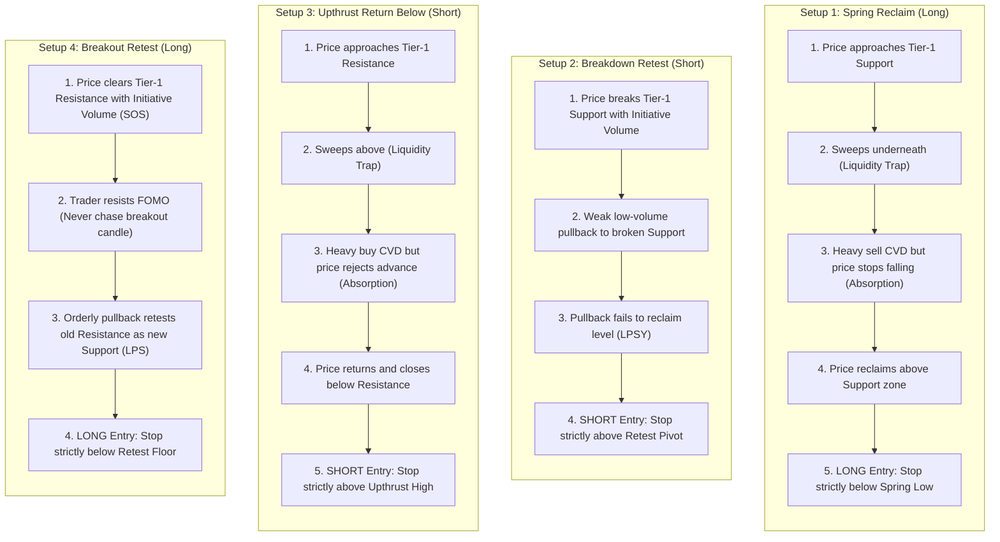

# 🧠 02. Institutional Strategy Playbook & Execution Edge

> **The 22-Rule Wyckoff Playbook, Auction Market Theory, Dalton Profile, and Session Strategies**  
> **Source Files**: [`lib/trading/wyckoffStrategy.ts`](file:///c:/Users/shahb/myApplications/Trading/lib/trading/wyckoffStrategy.ts), [`lib/trading/priceQuestioning.ts`](file:///c:/Users/shahb/myApplications/Trading/lib/trading/priceQuestioning.ts), [`lib/trading/marketControl.ts`](file:///c:/Users/shahb/myApplications/Trading/lib/trading/marketControl.ts), [`lib/trading/openingActivity.ts`](file:///c:/Users/shahb/myApplications/Trading/lib/trading/openingActivity.ts), [`lib/trading/dowAsiaRangeEdge.ts`](file:///c:/Users/shahb/myApplications/Trading/lib/trading/dowAsiaRangeEdge.ts), [`lib/trading/valueAcceptance.ts`](file:///c:/Users/shahb/myApplications/Trading/lib/trading/valueAcceptance.ts)

---

## 1. Core Trading Philosophy & Auction Market Theory

TradePulse approaches financial markets as **dual-auction mechanisms designed to facilitate trade**. Price is not an indicator; price is an advertising mechanism. Volume represents the acceptance or rejection of advertised prices.

```
                  ┌────────────────────────────────────────┐
                  │          PRICE ADVERTISES              │
                  │   (Moves up/down seeking buyers/sellers) │
                  └───────────────────┬────────────────────┘
                                      │
                                      ▼
                  ┌────────────────────────────────────────┐
                  │          TIME REGULATES                │
                  │   (Dwell time indicates acceptance)    │
                  └───────────────────┬────────────────────┘
                                      │
                                      ▼
                  ┌────────────────────────────────────────┐
                  │         VOLUME VALIDATES               │
                  │ (Heavy = Acceptance, Light = Rejection)│
                  └────────────────────────────────────────┘
```

### The Three Axioms:
1. **The Market is a Place to Do Business**: When price trades below accepted value (**Wholesale / Discount**), institutional responsive buyers accumulate. When price trades above accepted value (**Retail / Premium**), institutional responsive sellers distribute.
2. **Liquidity Lies Beyond Obvious Extremes**: Retail traders place stop losses directly outside swing highs and swing lows. Institutional algorithms hunt these liquidity pools to fill large order books. Therefore, our execution levels are positioned **at the stop-run pools (sweeps)**, never at the bait extremes.
3. **Patience is the Primary Edge**: If price is chopping inside yesterday's Value Area or hovering around the Point of Control (POC), **NO TRADE IS TAKEN**. A session with zero trades is a successful, disciplined session.

---

## 2. The Trader's 22 Wyckoff & AMT Rules (Absolute Execution Playbook)

Every automated setup, alert, and Leo AI critique adheres strictly to the **22 Execution Rules**:

| Rule # | Category | Core Execution Principle |
| :---: | :--- | :--- |
| **Rule 1** | **Watchlist & Scanning** | Primary watchlist: `NQ`, `ES`, `YM`, `Gold`, `Silver`, `Oil`. Never pre-decide that today is a "Nasdaq day". At the open, look for the market showing the best confluence of: **Volatility + Participation + Important Location**. |
| **Rule 2** | **Chart Hierarchy** | **Tier 1** (5D Profile, Yesterday Profile, Overnight) $\rightarrow$ **Tier 2** (Volume Effort vs Result, CVD) $\rightarrow$ **Tier 3** (5M AVWAP, VIX gauges). **Tier 3 can NEVER override Tier 1.** |
| **Rule 3** | **Pre-Market Map Gating** | Build zones before 09:30 ET (or 09:00 JST for Tokyo). Combine nearby levels into **ZONES** (not laser beams). **Freeze the map permanently at 09:30 ET**. Never invent new levels dynamically mid-session. Ignore random ranges away from zones. |
| **Rule 4** | **First Question After Open** | Never ask "Long or short?". Ask: *"Which of my important pre-marked zones is price approaching?"* If not near one $\rightarrow$ **NO TRADE**. |
| **Rule 5** | **Primary Long (Spring)** | Predetermined support zone sweep $\rightarrow$ sellers fail to continue $\rightarrow$ price reclaims zone $\rightarrow$ **LONG**. Buying the failed breakdown and reclaim, not the falling knife. |
| **Rule 6** | **Stop for Spring** | Stop loss goes strictly below the Spring low. If breached, hypothesis was wrong $\rightarrow$ exit immediately. Never widen the stop. |
| **Rule 7** | **CVD for Spring** | Bullish Absorption: Price makes equal/higher low while CVD makes lower low (heavy selling absorbed). CVD confirms quality; price reclaim triggers trade. |
| **Rule 8** | **Primary Short (Upthrust)** | Predetermined resistance sweep $\rightarrow$ buyers fail to continue $\rightarrow$ price returns below resistance $\rightarrow$ **SHORT**. Stop strictly above Upthrust high. |
| **Rule 9** | **CVD for Short** | Bearish Absorption: Price makes same/lower high while CVD makes higher high. Confirms passive sellers absorbing aggressive market buyers. |
| **Rule 10** | **Secondary (Breakout Retest)**| Never chase initial breakout candle! Wait for pullback to hold: Jump Across Creek (SOS) $\rightarrow$ Last Point of Support (LPS) for Long; Fall Through Ice (SOW) $\rightarrow$ LPSY for Short. |
| **Rule 11** | **The ONLY 4 Trades** | 1. Spring Reclaim (Long), 2. Breakdown Retest (Short), 3. Upthrust Return (Short), 4. Breakout Retest (Long). *Everything else: IGNORE.* |
| **Rule 12** | **Volume's Job** | Effort vs. Result. Heavy selling + little downward price progress = Absorption. Heavy buying + little upside progress = Absorption. |
| **Rule 13** | **CVD's Job** | Ask only: *"Is aggressive order flow actually achieving a result?"* Falling CVD + holding price = Bullish absorption. Rising CVD + rejecting price = Bearish absorption. |
| **Rule 14** | **Ignore Participant Identity**| Never speculate on "London is trapped" or "dealers hedging gamma". Trade observable, measurable auction behavior. |
| **Rule 15** | **Market Selection Method** | Across NQ/ES/YM/GC/CL, evaluate: 1. Is participation expanding? 2. Is price near a predetermined zone? 3. Is a setup forming? Focus 100% on the asset with all three. |
| **Rule 16** | **Highest-Ranked Asset Rule**| Do not trade the most volatile market. Trade the market with **Volatility + Location + Structure**. |
| **Rule 17** | **Take-Profit Rule ($\ge 2\text{R}$)**| Check distance to next major pre-marked zone before entering. If room to next major obstacle is $< 2.0\text{R}$, **SKIP THE TRADE**. |
| **Rule 18** | **Position Sizing** | Stop loss is determined strictly by market structure (Spring low / Upthrust high). Contract quantity is calculated from fixed dollar risk ($400 1R). |
| **Rule 19** | **Never Widen the Stop** | Invalidation is final. Exit immediately. Never turn -1R into -3R while holding an emergency internal seminar. |
| **Rule 20** | **Absolute Filters (When NOT to Trade)**| No predetermined zone $\rightarrow$ NO TRADE. Middle of value chop $\rightarrow$ NO TRADE. Random range $\rightarrow$ NO TRADE. Spring without reclaim $\rightarrow$ NO TRADE. Upthrust without return $\rightarrow$ NO TRADE. Breakout without pullback $\rightarrow$ DON'T CHASE. $< 2\text{R}$ room $\rightarrow$ NO TRADE. Confusing structure $\rightarrow$ NO TRADE. Nothing happens all day $\rightarrow$ **ZERO TRADES (Fully OK)**. |
| **Rule 21** | **Friday Rule** | Friday does not change the strategy. Setups stay identical. Be increasingly selective in the afternoon. Never force trades because it's Friday. |
| **Rule 22** | **Observable Structure Over Speculation**| Trade the observable auction event (Sweep & Reclaim / Spring / Upthrust), not speculative market narratives. |

---

## 3. The ONLY 4 Valid Trades in the Universe (Rule 11 Detailed)

In the TradePulse execution universe, exactly four structural setups are permitted:



### Detailed Setup Specifications

#### 1. Setup #1: Support Spring $\rightarrow$ Reclaim $\rightarrow$ LONG (Rule 5)
- **Location Requirement**: Predetermined Tier-1 Zone (5D LVN, Yesterday VAL, or Overnight Low).
- **Auction Event**: Price penetrates below the zone, enticing late retail breakout sellers.
- **Order Flow Confirmation (Tier 2)**: Cumulative Volume Delta (CVD) plunges downward while candlestick closes show long lower wicks or tight bodies. This represents **Bullish Absorption** (passive limit bids filling all aggressive market sell orders).
- **Trigger**: Candle closes back **ABOVE** the broken support boundary.
- **Protective Stop**: 1 tick below the absolute lowest wick of the Spring.
- **Minimum Target**: Prior POC or VAH offering $\ge 2.0\text{R}$.

#### 2. Setup #2: Support Breakdown $\rightarrow$ Failed Reclaim $\rightarrow$ SHORT (Rule 10/11)
- **Location Requirement**: Predetermined Tier-1 Support Zone.
- **Auction Event**: Decisive, wide-range initiative red candles slice cleanly through support.
- **Auction Retest**: Price pulls back to the underside of the broken support on declining volume (Fall Through Ice $\rightarrow$ Last Point of Supply / LPSY).
- **Trigger**: Price prints a lower high at the retest and prints a rejection candle.
- **Protective Stop**: 1 tick above the failed retest pivot.
- **Minimum Target**: Next macro support zone offering $\ge 2.0\text{R}$.

#### 3. Setup #3: Resistance Upthrust $\rightarrow$ Return Below $\rightarrow$ SHORT (Rule 8)
- **Location Requirement**: Predetermined Tier-1 Resistance Zone (5D HVN, Yesterday VAH, or Overnight High).
- **Auction Event**: Price pierces above the zone to trigger retail breakout buy stops.
- **Order Flow Confirmation (Tier 2)**: CVD surges upward to session highs while price stalls or closes with an upper wick. This represents **Bearish Absorption** (passive institutional limit offers absorbing aggressive market buys).
- **Trigger**: Candle cleanly returns and closes back **BELOW** the resistance level.
- **Protective Stop**: 1 tick above the absolute highest wick of the Upthrust.
- **Minimum Target**: Prior POC or VAL offering $\ge 2.0\text{R}$.

#### 4. Setup #4: Resistance Breakout $\rightarrow$ Successful Retest $\rightarrow$ LONG (Rule 10)
- **Location Requirement**: Predetermined Tier-1 Resistance Zone.
- **Auction Event**: Jump Across the Creek (Sign of Strength / SOS) on expanding volume.
- **Golden Rule**: **NEVER CHASE THE BREAKOUT CANDLE.** Wait for the pullback.
- **Auction Retest**: Price pulls back to test the former resistance ceiling as a new support floor (Last Point of Support / LPS).
- **Trigger**: Price holds the retest zone with absorption of sellers and rotates upward.
- **Protective Stop**: 1 tick below the retest swing low.
- **Minimum Target**: Next higher macro resistance zone offering $\ge 2.0\text{R}$.

---

## 4. The Three-Tier Structure & Chart Hierarchy (Rule 2)

```
┌────────────────────────────────────────────────────────────────────────┐
│ TIER 1: MANDATORY PRE-MARKET STRUCTURE (FROZEN AT 09:30 ET)            │
│ - 5-Day Volume Profile (5D POC, 5D HVNs, 5D LVNs)                     │
│ - Yesterday Volume Profile (Yesterday VAH, POC, VAL, High, Low)       │
│ - Overnight / London Profile (Overnight High, Low, POC)               │
└───────────────────────────────────┬────────────────────────────────────┘
                                    │
                                    ▼
┌────────────────────────────────────────────────────────────────────────┐
│ TIER 2: EXECUTION CONFIRMATION (ORDER FLOW & EFFORT VS RESULT)         │
│ - Current Candlestick Price Action at Key Levels                       │
│ - Candlestick Volume Bars (Volume Expansion vs Contraction)            │
│ - Cumulative Volume Delta (CVD Absorption & Divergence)                │
└───────────────────────────────────┬────────────────────────────────────┘
                                    │
                                    ▼
┌────────────────────────────────────────────────────────────────────────┐
│ TIER 3: CONTEXT ONLY — NEVER OVERRIDES TIER 1                          │
│ - 5-Month Anchored VWAP (5M AVWAP Center & ±1σ/±2σ/±3σ Bands)          │
│ - Cross-Asset Volatility Gauges (VIX1D, OVX, GVZ, JNIV)                │
└────────────────────────────────────────────────────────────────────────┘
```

### Pre-Market Map Gating & The 09:30 ET Freeze Rule
- At 09:00–09:25 ET, the trader and workstation map key levels and cluster them into **ZONES** (e.g., 20-point zone on NQ, 40-point zone on YM).
- **At 09:30 ET (Montreal/NY cash open), the map is frozen permanently.**
- No dynamic levels may be created during live session trading. If a consolidation range forms in the middle of nowhere: **IT IS 100% IGNORED**.

---

## 5. The 8-Step Screen-Reading Sequence (Rule 23)

Before any trade hypothesis is validated or executed, the trader and Leo AI run through the **8-Step Screen-Reading Sequence**:

$$\boxed{\text{1. LOCATION}} \longrightarrow \boxed{\text{2. REACTION}} \longrightarrow \boxed{\text{3. RESULT}} \longrightarrow \boxed{\text{4. CVD + VOL}} \longrightarrow \boxed{\text{5. TRIGGER}} \longrightarrow \boxed{\text{6. RISK}} \longrightarrow \boxed{\text{7. REWARD } (\ge 2\text{R})} \longrightarrow \boxed{\text{8. ENTER}}$$

1. **LOCATION**: Is price currently interacting with one of our frozen Tier-1 zones? (If NO $\rightarrow$ Stand aside).
2. **REACTION**: Did price sweep through the level and attempt auction expansion?
3. **RESULT**: Did the sweep fail to continue (Spring or Upthrust)?
4. **CVD + VOLUME**: Is aggressive market order flow being absorbed by passive institutional limit orders?
5. **TRIGGER**: Has price cleanly reclaimed the key structural level?
6. **RISK**: Is the structural invalidation stop clearly defined beyond the pivot?
7. **REWARD**: Is there at least $\ge 2.0\text{R}$ of clean runway before the next opposing pre-marked obstacle?
8. **ENTER**: Execute disciplined order sizing with fixed dollar risk ($400 1R).

---

## 6. Dalton Market Profile & Auction Theory (`marketControl.ts`, `openingActivity.ts`)

The system evaluates intraday price development through James Dalton's auction principles (*Mind Over Markets*):

### 6.1 Dalton Opening Activity Classifications

Measured on closed 5-minute bars starting at 09:30 ET:

1. **Open-Drive (`OPEN_DRIVE`)**:
   - Market opens and drives aggressively in one direction without retracing through the opening price.
   - Characterized by massive institutional conviction. Requires trend-continuation trade mode.
2. **Open-Test-Drive (`OPEN_TEST_DRIVE`)**:
   - Market opens, quickly tests an important prior reference level (e.g., Yesterday High or VAH), finds strong responsive buyers/sellers, and then drives aggressively in the opposite direction.
3. **Open-Rejection-Reverse (`OPEN_REJECTION_REVERSE`)**:
   - Market drives in one direction, encounters extreme rejection/absorption at a key level, and reverses violently back through the open.
4. **Open-Auction (`OPEN_AUCTION`)**:
   - Market opens inside yesterday's range, showing no immediate directional initiative. Price brackets around the opening price. Fades of range extremes are favored.

### 6.2 Dalton Rotation Factor (RF) & Developing POC (dPOC)

The Market Control engine (`lib/trading/marketControl.ts`) calculates the **Rotation Factor (RF)** and **Developing POC (dPOC)**:

- **Letter Resolution Hierarchy**:
  - Open Range (09:30–09:45): 5-minute periods.
  - OR30 Window (09:45–10:30): 10-minute and 15-minute periods.
  - After Initial Balance (10:30+): Classic 30-minute TPO letters (Period A, B, C, etc.).
- **Rotation Factor Calculation**:
  - For each new period, if the high is higher than the previous high: $+1$. If lower: $-1$.
  - If the low is higher than the previous low: $+1$. If lower: $-1$.
  - A cumulative score reflects **One-Time Framing (OTF Buy / OTF Sell)** vs. **Two-Time Framing (Balance/Chop)**.
- **Developing POC (dPOC)**:
  - Tracks the continuous migration of high-volume nodes intraday. Rising dPOC confirms buyer value acceptance; falling dPOC confirms seller value acceptance; stationary dPOC indicates rotational equilibrium.

---

## 7. Systematic Timeframe Window Strategies

The trading day is partitioned into structured, sequential execution playbooks:

```
02:00 ET        09:30 ET      09:45 ET      10:00 ET      10:30 ET      15:15 ET   16:59 ET
   │               │             │             │             │             │          │
   ├───────────────┼─────────────┼─────────────┼─────────────┼─────────────┼──────────┤
   ▼               ▼             ▼             ▼             ▼             ▼          ▼
[ASIA BREAKOUT] [PRE-MARKET]  [OR15 RANGE]  [OR30 RANGE]  [IB RANGE]    [LATE EXIT][HARD FLATTEN]
  Dow <80 pts      Freeze Map    Breakout      Midpoint      Rotations     No Entries   All Closed
```

### Strategy #1: Dow Asia Narrow Range Compression Breakout (`ASIA`)
* **File**: [`lib/trading/dowAsiaRangeEdge.ts`](file:///c:/Users/shahb/myApplications/Trading/lib/trading/dowAsiaRangeEdge.ts)
* **Execution Window**: **02:00 AM ET (Montreal Time)**
* **Scan Range**: 8:00 PM ET to 2:00 AM ET (20:00 – 02:00 ET)
* **Compression Filter**:
  $$\text{Asia Range} = \text{Asia High} - \text{Asia Low}$$
  - **Rule**: If $\text{Asia Range} < 80\text{ points}$, Compression Edge is **ACTIVE** 🟢.
  - If $\text{Asia Range} \ge 80\text{ points}$, Range is too wide $\rightarrow$ **STAND ASIDE** 🔴.
* **Order Placement**:
  - **Buy Stop**: $\text{Asia High} + 20\text{ points}$
  - **Sell Stop**: $\text{Asia Low} - 20\text{ points}$
  - **Stop Loss**: $\text{Asia Midpoint} = \frac{\text{Asia High} + \text{Asia Low}}{2}$
  - **Take Profit**: **`1.50 R`** ($1.50 \times \text{Risk Distance}$)

### Strategy #2: 15-Minute Open Range Breakout (`OR15`)
* **Execution Window**: **09:45 AM ET (RTH Open)**
* **Establishment Window**: 09:30 AM – 09:45 AM ET (First 15 minutes of RTH).
* **Strategy Mechanics**:
  - Tracks high and low established during cash open volatility.
  - Triggers Buy Stop on initiative candle close above OR15 High, or Sell Stop below OR15 Low.
* **Stop Loss**: Opposite boundary of OR15 range (or fixed 20 pts on MNQ).
* **Take Profit**: **`2.00 R`** (2.0x risk distance).

### Strategy #3: 30-Minute Open Range Midpoint Continuation (`OR30`)
* **Execution Window**: **10:00 AM – 10:30 AM ET**
* **Establishment Window**: 09:30 AM – 10:00 AM ET (First 30 minutes of RTH).
* **Strategy Mechanics**:
  - Calculates the 50% midpoint of the 30-minute opening range.
  - When One-Time-Framing buyers hold value above midpoint, places limit entry on pull-back to 50% level.
* **Stop Loss**: Below OR30 50% midpoint (20 pts on MNQ).
* **Take Profit**: **`2.00 R`** targeting macro 20-day VPOC/VAH.

### Strategy #4: Initial Balance 60-Minute Range Rotation (`IB`)
* **Execution Window**: **10:30 AM – 15:15 PM ET**
* **Establishment Window**: 09:30 AM – 10:30 AM ET (First hour range).
* **Strategy Mechanics**:
  - Identifies responsive buyers at IB Low or responsive sellers at IB High when auction shows rotational acceptance.
  - Fades extreme when Point of Control (POC) rejects expansion.
* **Stop Loss**: Beyond IB structural extreme + buffer (e.g. 4 pts Gold, 40 pips Euro FX, $0.40 Silver).
* **Take Profit**: **`2.00 R`** targeting IB midpoint / opposite extreme.

---

## 8. Value Acceptance Engine (`valueAcceptance.ts`)

While a trade position is active, the **Value Acceptance Engine** continuously assesses whether price is auctioning efficiently toward the take profit or consolidating back at the entry:

- **Pocket Definition**:
  $$\text{Pocket Bounds} = \text{Entry Price} \pm (0.3 \times \text{Risk } R)$$
- **State Classifications**:
  1. `still_auctioning`: Price has made progress toward TP ($> 0.5R$) and is moving directional.
  2. `looking_balanced`: Price is fluctuating within the trade range without momentum.
  3. `looking_accepted`: Price has remained pinned inside the entry pocket for $> 8 \text{ to } 20\text{ minutes}$, indicating that the initial directional impulse has failed and market participants are accepting value at the entry price.
- **Trader Advisory**: Emits an alert: *"Price is building value at entry — not confirming."* Advises the trader to consider manual early exit or tightening protection.
