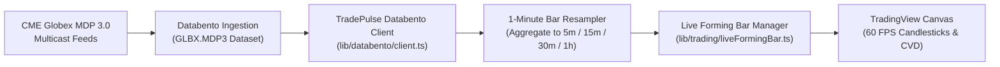

# 🏛️ 04. CME Globex Exchange Integration & Contract Specifications

> **CME Globex Futures Specifications, Databento MDP 3.0 Feed, CME Basis, and Session Clocks**  
> **Source Files**: [`lib/trading/cmeContracts.ts`](file:///c:/Users/shahb/myApplications/Trading/lib/trading/cmeContracts.ts), [`lib/databento/client.ts`](file:///c:/Users/shahb/myApplications/Trading/lib/databento/client.ts), [`lib/trading/cmeBasis.ts`](file:///c:/Users/shahb/myApplications/Trading/lib/trading/cmeBasis.ts), [`lib/chart/sessionVwap.ts`](file:///c:/Users/shahb/myApplications/Trading/lib/chart/sessionVwap.ts)

---

## 1. CME Globex Exchange Role in TradePulse

TradePulse utilizes the **Chicago Mercantile Exchange (CME) Globex electronic trading platform** as its primary source of institutional market truth:

1. **Centralized Liquidity & Order Flow**: Unlike decentralized OTC or retail CFD quotes, CME Globex provides a transparent, consolidated limit order book with verifiable Cumulative Volume Delta (CVD) and time-and-sales execution prints.
2. **Analysis vs Execution Decoupling**: Market structure analysis, Dalton market profiles, and Wyckoff factor scores are derived from real CME Globex data. Execution is then routed to CME Direct Futures (Personal Futures $50k Account) or CMC Markets CFDs.

---

## 2. CME Contract Specifications & Point Values

Every instrument tracked on the desk has precisely defined contract multipliers, tick sizes, and maximum position size caps (`lib/trading/cmeContracts.ts`):

```
┌────────────────────────────────────────────────────────────────────────────────────────┐
│ CME GLOBEX FUTURES SPECIFICATION MATRIX                                                │
├──────────────┬────────┬─────────────┬──────────────┬──────────────┬────────┬───────────┤
│ Asset Name   │ Mini   │ Micro       │ Mini Point   │ Micro Point  │ Tick   │ Max Cap   │
│              │ Ticker │ Ticker      │ Value ($/pt) │ Value ($/pt) │ Size   │ (Min/Mic) │
├──────────────┼────────┼─────────────┼──────────────┼──────────────┼────────┼───────────┤
│ Nasdaq-100   │ NQ     │ MNQ         │ $20.00       │ $2.00        │ 0.25   │ 4 / 40    │
│ Dow Jones 30 │ YM     │ MYM         │ $5.00        │ $0.50        │ 1.00   │ 4 / 40    │
│ Nikkei 225   │ NKD    │ — (USD Fut) │ $5.00        │ —            │ 5.00   │ 4 / 0     │
│ Gold         │ GC     │ MGC         │ $100.00      │ $10.00       │ 0.10   │ 4 / 40    │
│ WTI Crude    │ CL     │ MCL         │ $1,000.00    │ $100.00      │ 0.01   │ 4 / 40    │
│ Silver       │ SI     │ SIL         │ $5,000.00    │ $1,000.00    │ 0.005  │ 2 / 20    │
│ Russell 2000 │ RTY    │ M2K         │ $50.00       │ $5.00        │ 0.10   │ 4 / 40    │
│ Euro FX      │ 6E     │ M6E         │ $12.50/pip   │ $1.25/pip    │ 0.0001 │ 4 / 40    │
└──────────────┴────────┴─────────────┴──────────────┴──────────────┴────────┴───────────┘
```

### Detailed Contract Specifications

#### 1. E-mini & Micro E-mini Nasdaq-100 (`NQ` / `MNQ`)
- **Underlying Index**: Nasdaq-100 Index (Modified Market Capitalization)
- **Contract Size**: $20 \times \text{Index}$ (NQ) | $2.00 \times \text{Index}$ (MNQ)
- **Minimum Tick**: 0.25 index points = $5.00 on NQ | $0.50 on MNQ
- **Trading Hours**: Sunday 18:00 ET to Friday 17:00 ET (Daily halt 17:00–18:00 ET)
- **Desk Role**: Primary high-beta equity benchmark. Volatility leader.

#### 2. E-mini & Micro E-mini Dow Jones (`YM` / `MYM`)
- **Underlying Index**: Dow Jones Industrial Average (Price-Weighted 30 Blue Chips)
- **Contract Size**: $5.00 \times \text{Index}$ (YM) | $0.50 \times \text{Index}$ (MYM)
- **Minimum Tick**: 1.00 index point = $5.00 on YM | $0.50 on MYM
- **Desk Role**: Cyclical rotation benchmark. Home of the Dow Asia Compression Breakout strategy.

#### 3. Nikkei 225 USD Futures (`NKD`)
- **Underlying Index**: Nikkei 225 Stock Average (Tokyo Stock Exchange)
- **Contract Currency**: Quoted and settled in **US Dollars** on CME Globex
- **Contract Size**: $5.00 \times \text{Index}$
- **Minimum Tick**: 5.00 index points = $25.00
- **Desk Role**: Primary Asian session night-trading instrument (Tokyo cash open 09:00 JST / 20:00 EDT).

#### 4. COMEX Gold & Micro Gold Futures (`GC` / `MGC`)
- **Underlying Asset**: 100 troy ounces (GC) | 10 troy ounces (MGC)
- **Contract Size**: $100.00 per point ($1.00/troy oz) on GC | $10.00 per point on MGC
- **Minimum Tick**: 0.10 points = $10.00 on GC | $1.00 on MGC
- **Desk Role**: Safe haven and monetary hedge. Driven by US Real Yields and USD strength.

#### 5. NYMEX Light Sweet Crude Oil (`CL` / `MCL`)
- **Underlying Asset**: 1,000 barrels WTI (CL) | 100 barrels WTI (MCL)
- **Contract Size**: $1,000.00 per point ($1.00/barrel) on CL | $100.00 per point on MCL
- **Minimum Tick**: 0.01 points (1 cent/barrel) = $10.00 on CL | $1.00 on MCL
- **Desk Role**: Energy macro indicator. Highly sensitive to geopolitical tensions and EIA inventory prints.

#### 6. COMEX Silver & Micro Silver Futures (`SI` / `SIL`)
- **Underlying Asset**: 5,000 troy ounces (SI) | 1,000 troy ounces (SIL)
- **Contract Size**: $5,000.00 per point on SI | $1,000.00 per point on SIL
- **Minimum Tick**: 0.005 points (0.5 cents/oz) = $25.00 on SI | $5.00 on SIL
- **Desk Role**: High-volatility precious and industrial metal hybrid.

---

## 3. Databento MDP 3.0 Market Data Feed Integration

TradePulse connects directly to CME Globex Market Data Protocol (MDP 3.0) via Databento (`lib/databento/client.ts`):



### Feed Specifications & Failover Architecture:
1. **Dataset**: `GLBX.MDP3` (CME Globex Market Data Platform 3.0).
2. **Schema**: 1-minute OHLCV bars with tick count and traded volume.
3. **Recent Lookback Window**: Standard lookback queries request 45 minutes of recent 1m candles for immediate intraday responsiveness.
4. **Resampling Engine (`aggregateCandles`)**: Resamples 1-minute Databento bars into clean 5-minute desk bars aligned to exchange clock boundaries (e.g. 09:30:00, 09:35:00, etc.).
5. **Feed Latency Selector (`feedLatencySelector.ts`)**: Monitored round-trip latency. If Databento connection degrades, the system automatically falls back to Yahoo Finance streaming quotes without disrupting chart calculations.

---

## 4. CME Basis & Fair Value Calculation (`cmeBasis.ts`)

To reconcile CME futures prices with cash index spot prices (and CMC CFD cash markets), the system calculates the **Theoretical CME Basis**:

$$\text{Basis} = \text{Futures Price} - \text{Cash Spot Price}$$

$$\text{Fair Value} = \text{Spot Price} \times \left( 1 + [r - q] \times \frac{T}{365} \right)$$

Where:
- $r$ = US Risk-Free Interest Rate (SOFR / 3-Month US Treasury yield)
- $q$ = Annualized Index Dividend Yield (S&P 500 / Nasdaq-100 dividend rate)
- $T$ = Days to futures contract expiration (quarterly March, June, September, December cycles)

### Practical Utility on the Desk:
When the trader executes on CMC Markets CFDs (which track Cash Index spot), the CME Basis is dynamically added/subtracted to align CME Globex volume profile levels (VAH, VAL, POC) onto the CFD execution chart.

---

## 5. CME Globex Session Hours & Trading Clocks

TradePulse operates strictly according to official exchange operating hours:

```
┌────────────────────────────────────────────────────────────────────────┐
│ CME GLOBEX WEEKLY TRADING SCHEDULE (NEW YORK / MONTREAL TIME)          │
├────────────────────────────────────────────────────────────────────────┤
│ Sunday 18:00 ET: CME Globex Opens for the Week                        │
│ Monday - Thursday:                                                     │
│   - 17:00 - 18:00 ET: Daily Maintenance Shutdown (Trading Halted)       │
│   - 18:00 ET: Next Session Globex Open (Asian Session Begins)          │
│   - 02:00 ET: Asia Range Scan Window (Dow Compression)                 │
│   - 03:00 ET: London Financial Open                                    │
│   - 09:30 ET: US Equity Cash Session Open (RTH Open - Freeze Map)      │
│   - 16:00 ET: US Equity Cash Session Close                             │
│   - 17:00 ET: CME Daily Close / Maintenance Break                      │
│ Friday 17:00 ET: CME Globex Weekend Close                              │
└────────────────────────────────────────────────────────────────────────┘
```

### Tokyo / Osaka Exchange (OSE) Session Clocks (`sessionVwap.ts`):
- **08:45 JST (19:45 EDT)**: OSE Nikkei Futures Open.
- **09:00 JST (20:00 EDT)**: Tokyo Stock Exchange (TSE) Cash Open. **Map Freeze Time for Nikkei.**
- **11:30–12:30 JST**: TSE Cash Lunch Break.
- **15:00 JST (02:00 EDT)**: TradePulse Desk Profile Close (Session Ends).
- **15:30 JST**: TSE Cash Official Close.
- **15:45 JST**: OSE Futures Day Session Close.
