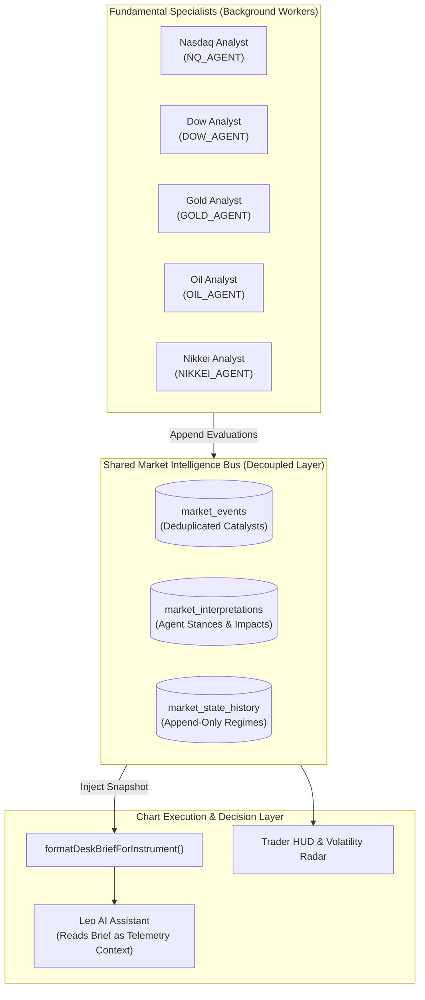

# 🌐 06. CMC Markets CFD Desk, Performance Audit & Fundamental Intelligence Bus

> **CMC Markets Canada CFD Performance Ledger, Market Intelligence Bus, and 5 Fundamental Specialist Agents**  
> **Source Files**: [`CMC_MARKETS_PERFORMANCE_AUDIT.md`](file:///c:/Users/shahb/myApplications/Trading/CMC_MARKETS_PERFORMANCE_AUDIT.md), [`lib/trading/cmcMarketsTrades.ts`](file:///c:/Users/shahb/myApplications/Trading/lib/trading/cmcMarketsTrades.ts), [`lib/trading/cmcJournalAdapter.ts`](file:///c:/Users/shahb/myApplications/Trading/lib/trading/cmcJournalAdapter.ts), [`lib/ai/marketIntelligenceBus.ts`](file:///c:/Users/shahb/myApplications/Trading/lib/ai/marketIntelligenceBus.ts), [`lib/fundamentals/outputContract.ts`](file:///c:/Users/shahb/myApplications/Trading/lib/fundamentals/outputContract.ts)

---

## 1. CMC Markets Canada CFD Desk Overview

In addition to CME direct futures and personal futures accounts, TradePulse supports CFD execution via **CMC Markets Canada** (denominated in Canadian Dollars - CAD):

- **Execution Instruments**: Cash index and commodity CFDs tracking global benchmarks with flexible fractional unit sizes.
- **Role in the Trading Architecture**: Enables small-capitalization testing, overnight swing positioning, and fractional risk calibration without the full margin commitments of standard futures contracts.

---

## 2. CMC Markets Performance Audit & Quantitative Ledger Analysis

An exhaustive audit of **85 authentic live fills** executed on the CMC Markets Canada CFD desk (02 Oct 2026 – 09 Oct 2026) demonstrates the mathematical validity of the system's risk-to-reward asymmetry:

```
┌─────────────────────────────────────────────────────────────────────────────────────────┐
│ 📊 CMC MARKETS CFD ACCOUNT RECONCILIATION & AUDIT SUMMARY                               │
├─────────────────────────────────────────────────────────────────────────────────────────┤
│ Initial Deposit (02 Oct 2026 07:55 EDT):                     +$2,000.00 CAD             │
│ Cash Withdrawal (07 Oct 2026 12:43 EDT):                       -$200.00 CAD             │
│ Gross Realized Trading Profit (31 Wins):                       +$829.64 CAD             │
│ Gross Realized Trading Loss (54 Losses):                       -$697.51 CAD             │
│ Net Realized Trading P&L:                                      +$132.13 CAD             │
│ Financing & Holding Costs / Adjustments:                          -$2.76 CAD             │
│ ─────────────────────────────────────────────────────────────────────────────────────── │
│ FINAL ACCOUNT CASH BALANCE:                                   $1,929.69 CAD             │
│ Net Return on $2,000 Starting Capital:                         +6.47% Realized Return   │
└─────────────────────────────────────────────────────────────────────────────────────────┘
```

### Key Quantitative KPIs

| Metric | Measured Value | Institutional Benchmark | Assessment |
| :--- | :---: | :---: | :--- |
| **Total Closed Trades** | **85 Fills** | — | High execution sample size across 6 active sessions. |
| **Winning Fills** | **31 Trades** | — | 36.5% Win Rate. |
| **Losing Fills** | **54 Trades** | — | 63.5% Loss Rate. |
| **Profit Factor** | **1.19** | $\ge 1.15$ | Gross Profit ($829.64) / Gross Loss ($697.51). |
| **Average Win** | **+$26.76 CAD** | — | Wins extended aggressively toward 2R targets. |
| **Average Loss** | **-$12.92 CAD** | — | Losses truncated rapidly at structural invalidation. |
| **Win / Loss Ratio** | **2.07 : 1** | $\ge 1.80$ | **Primary Edge**: Wins are $2.07\times$ larger than losses. |
| **Largest Winning Trade** | **+$149.79 CAD** | — | Gold Cash Long Take-Profit (`06 Oct 04:22 EDT`). |
| **Largest Losing Trade** | **-$38.05 CAD** | — | Crude Oil WTI Stop-Loss (`05 Oct 14:40 EDT`). |

### Performance by Asset Class & Instrument

| Product Name | Symbol | Trades | Win % | Gross Win | Gross Loss | Net P&L (CAD) | Profit Factor |
| :--- | :---: | :---: | :---: | :---: | :---: | :---: | :---: |
| **Japan 225 - Cash** | `NK225` | 7 | **57.1%** | +$112.00 | -$29.00 | **+$83.00** | **3.86** |
| **US NDAQ 100 - Cash** | `MNQ` | 19 | **47.4%** | +$163.99 | -$89.04 | **+$74.95** | **1.84** |
| **US 30 - Cash** | `MYM` | 12 | **50.0%** | +$119.14 | -$53.88 | **+$65.26** | **2.21** |
| **Gold - Cash** | `MGC` | 18 | **22.2%** | +$235.37 | -$177.78 | **+$57.59** | **1.32** |
| **Crude Oil Brent - Cash**| `BRENT`| 2 | **50.0%** | +$16.25 | -$6.52 | **+$9.73** | **2.49** |
| **Silver - Cash** | `SIL` | 5 | **40.0%** | +$39.86 | -$68.77 | **-$28.91** | **0.58** |
| **Crude Oil WTI - Cash** | `MCL` | 22 | **22.7%** | +$143.03 | -$272.52 | **-$129.49**| **0.52** |
| **DESK TOTALS** | — | **85** | **36.5%** | **+$829.64** | **-$697.51** | **+$132.13 CAD**| **1.19** |

### Core Strategic Takeaways from the Audit:
1. **Index Dominance (+ $223.21 CAD Net)**: Japan 225, Nasdaq 100, and Dow 30 delivered a combined **50.0% win rate** and a **2.37 Profit Factor**, confirming that equity indices respect auction profile zones with superior consistency.
2. **Commodity Chop Drain (-$129.49 CAD on WTI)**: WTI Crude chop drained performance during unstructured midday consolidations. As a result, commodity trading rules now mandate stricter Tier-1 volume expansion filters.

---

## 3. The Market Intelligence Bus Architecture

The **Market Intelligence Bus** (`lib/ai/marketIntelligenceBus.ts`, `supabase/migrations/20261004_market_intelligence_bus.sql`) decouples macroeconomic fundamentals from intraday chart auditing:



### Canonical Market Resolution (`canonicalMarkets.ts`):
All events and state updates resolve into 5 canonical IDs:
- **`YM`**: Dow Jones Industrial Average (DOW, MYM, DJIA)
- **`NQ`**: Nasdaq-100 (NASDAQ, MNQ, NDX, QQQ)
- **`GC`**: Gold (GOLD, MGC, XAU)
- **`CL`**: WTI Crude Oil (CRUDE, MCL, OIL, WTI)
- **`NK225`**: Nikkei 225 (NIKKEI, NKD, Japan 225)

---

## 4. Shared Fundamental Agent Contract (`outputContract.ts`)

All five fundamental specialists operate under strict mathematical and prompt constraints:

### Universal Rules for Fundamental Agents:
1. **Zero Placeholder & Zero Hallucination Policy**: Never invent fake surprise percentages, fake index point contributions, or fabricated reactions. If data is unsupplied, emit `null` and mark status as `UNAVAILABLE`.
2. **Code Computes, Models Interpret**: Economic surprise standard deviations and index point weights are calculated in TypeScript before being passed to the model.
3. **Freshness Classification**: Every data point is tagged with freshness: `LIVE`, `RECENT`, `SLOW_MOVING`, `STALE`, or `STALE_FOR_INTRADAY`.
4. **Candidate Interpretation Only**: Agent outputs represent candidate interpretations for a specific timestamp. They do not directly alter the persisted market regime until processed by the state reducer.
5. **Never Issue Trades**: Fundamental agents evaluate macro catalysts. They **never** generate buy/sell trade recommendations.

### Universal Event Evaluation JSON Envelope:
```json
{
  "schema_version": "1.0",
  "market": "NQ",
  "event_id": null,
  "event_type": "US_CPI",
  "source": { "name": "BLS", "published_at": "2026-10-12T12:30:00Z", "reliability": "PRIMARY" },
  "expected_effect": { "direction": "BEARISH", "magnitude": "HIGH" },
  "state": { "intraday": "BEARISH", "short_term": "MIXED", "medium_term": "BULLISH" },
  "market_reaction": { "status": "PENDING_REACTION_ENGINE" },
  "abnormal_behavior": { "detected": false, "type": null },
  "confidence": "HIGH",
  "invalidation": "Clean reclaim of 5D POC on positive CVD absorption",
  "evidence": {
    "facts": ["Core CPI MoM +0.3% vs +0.2% consensus"],
    "estimates": ["Fed terminal rate implied pricing +15 bps"],
    "interpretations": ["Higher rates increase discount factor on long-duration mega-cap tech"],
    "unknowns": ["Reaction of Big Tech capex plans"],
    "conflicts": ["Lower oil prices dampening headline index"]
  },
  "specialist": {}
}
```

---

## 5. The Five Fundamental Specialist Agents

### 1️⃣ Nasdaq Analyst (`NQ_AGENT` — `nasdaqAnalystConfig.ts`)
- **Primary Market**: CME E-mini Nasdaq-100 Futures (`NQ`).
- **Core Drivers**: Fed rate expectations, nominal & real yields (US 10Y / 2Y), tech earnings & guidance, AI capex cycles, semiconductor supply chains, index breadth.
- **Constituent Weights**: Incorporates updated modified-market-cap index weights (NVIDIA 8.4%, Microsoft 8.1%, Apple 7.9%, Amazon 5.6%, Alphabet 5.3%, Meta 4.9%, Broadcom 4.6%, Tesla 3.3%).
- **Standardized Surprise Volatility**: Measures macro deviations in terms of historical standard deviations ($\sigma$):
  - Non-Farm Payrolls: $\sigma = 55,000$ jobs
  - Core CPI MoM: $\sigma = 0.07\%$
  - Core PCE MoM: $\sigma = 0.06\%$

### 2️⃣ Dow Analyst (`DOW_AGENT` — `dowAnalystConfig.ts`)
- **Primary Market**: CME E-mini Dow Futures (`YM`).
- **Index Construction**: Price-weighted average of 30 blue-chip stocks.
- **Divisor Mechanics**: Evaluates individual stock moves via the Dow Divisor ($d \approx 0.1517$); a $\$1.00$ stock move translates to $\approx 6.59$ Dow points.
- **Key Themes**: Industrials capex, consumer spending, credit conditions, tariff and global trade policies.

### 3️⃣ Gold Analyst (`GOLD_AGENT` — `goldAnalystConfig.ts`)
- **Primary Market**: COMEX Gold Futures (`GC`).
- **Transmission Hierarchy**:
  $$\text{Real Rates } (10\text{Y TIPS}) \longrightarrow \text{Nominal Rates } (10\text{Y}) \longrightarrow \text{US Dollar Index } (\text{DXY}) \longrightarrow \text{Physical / Reserve Demand}$$
- **Key Themes**: Negative correlation with real yields, central bank reserve purchases (PBoC, RBI), COMEX vault inventories, geopolitical escalation risk.

### 4️⃣ Crude Oil Analyst (`OIL_AGENT` — `oilAnalystConfig.ts`)
- **Primary Market**: NYMEX WTI Crude Oil (`CL`).
- **Core Drivers**: EIA Weekly Petroleum Status Report (crude, gasoline, distillate builds/draws), OPEC+ production quotas, Strategic Petroleum Reserve (SPR) actions, refinery crack spreads, geopolitical choke points (Strait of Hormuz, Red Sea).

### 5️⃣ Nikkei Analyst (`NIKKEI_AGENT` — `nikkeiAnalystConfig.ts`)
- **Primary Market**: CME Nikkei 225 USD Futures (`NKD`) & Tokyo Cash (`NK225`).
- **Index Construction**: Price-weighted index with standard divisor ($30.15$).
- **Key Themes**: Bank of Japan (BoJ) monetary policy & Yield Curve Control (YCC), USD/JPY currency velocity & MoF intervention risk, export competitiveness, Tokyo (TSE) cash vs. Osaka (OSE) futures session dynamics.
