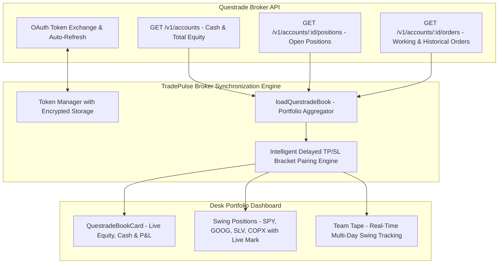

# Broker & Futures Integrations: Questrade & Institutional Ledger

> **TradePulse Execution & Portfolio Layer**  
> **Live Broker Integration**: Questrade (OAuth API, Multi-Day Swings, Intelligent Delayed TP/SL Pairing)  
> **Futures Ledger Integration**: Personal Futures Desk Ledger & Daily Equity Engine  

---

## 1. Questrade Live Broker Integration

TradePulse integrates directly with **Questrade's REST API** for live equity tracking, multi-day swing position monitoring, and execution order management.



### 1.1 Authentication & Auto-Refresh Flow
- **Initial Setup**: The trader provides a one-time API refresh token via `QUESTRADE_REFRESH_TOKEN`.
- **Token Exchange (`lib/questrade/auth.ts`)**: Exchanges the refresh token for a short-lived bearer access token and a new refresh token. Tokens are stored securely and refreshed automatically before expiration.

### 1.2 Multi-Day Position Persistence
Unlike intraday scalps that flatten at 16:59 EDT, swing equity positions (e.g. SPY, GOOG, SLV, COPX) are held across multi-day and multi-week horizons:
- `loadQuestradeBook` queries all open positions regardless of their original fill date.
- Open positions are mapped into `/api/trading/team-tape`, ensuring they are continuously tracked with live marks, average entry prices, and open P&L.

---

## 2. Intelligent Delayed TP/SL Bracket Pairing (`lib/trading/questradeOrders.ts`)

### 2.1 The Delayed Order Pairing Problem
In Questrade and many retail brokerages:
- Take-Profit (Sell Limit) and Stop-Loss (Sell Stop) orders are frequently placed **hours, days, or weeks after the initial position was filled** (e.g. SPY entered on Aug 20 @ 765; TP Limit @ 772 placed on Sep 9).
- These delayed orders **do not contain broker `parentId` or `orderGroupId` links** connecting them back to the original entry order.
- Naive matching engines either fail to find the bracket orders or mistakenly attach open position targets to unexecuted working buy limits (e.g. assigning a 772 target to an unfilled Buy 1 SPY @ 765 limit).

### 2.2 Solution: Multi-Factor Pairing Algorithm
TradePulse implements a multi-factor pairing algorithm:

```
[Candidate Order]
        │
        ▼
   Price Relationship Sanity Check
   ├── Long Position:  Take Profit > Entry  AND  Stop Loss < Entry
   └── Short Position: Take Profit < Entry  AND  Stop Loss > Entry
        │ (Fails sanity? -> Disqualified)
        ▼
   Recency & Status Scoring
   ├── Active 'Working' orders: +100 base score
   ├── Recency weight: (orderPlacedEpoch / 1e10) * 10
   └── Quantity match: +20 bonus if order.qty === position.qty
        │
        ▼
   Unexecuted Limit Isolation
   └── Working entry limits require explicit bracket IDs;
       they are NEVER assigned an open position's targets.
```

### 2.3 Empirical Verification
Verified against live Questrade account data:
- **SPY**: Long entry 765 $\rightarrow$ accurately paired with TP Sell Limit @ 772 (placed 20 days later).
- **GOOG**: Long entry 345 $\rightarrow$ accurately paired with TP Sell Limit @ 350 (placed 13 days later).
- **SLV**: Long entry 58.49 $\rightarrow$ accurately identified with no active stop/target (`stop: null, target: null`).
- **COPX**: Long entry 89.52 $\rightarrow$ accurately identified with no active stop/target (`stop: null, target: null`).
- **Unexecuted Working Limits** (e.g. Buy 1 GOOG @ 330, Buy 1 SPY @ 750) strictly maintain `target: null, stop: null`.

---

## 3. Personal Futures Desk Ledger & Equity Architecture

TradePulse maintains continuous telemetry and risk analytics for the personal futures desk ledger:

```
┌────────────────────────────────────────────────────────────────────────┐
│ 📊 FUTURES DESK LEDGER (Personal Account)                              │
├────────────────────────────────────────────────────────────────────────┤
│ Desk Balance:  $50,000.00      Daily Loss Limit:  $500.00               │
│ Risk per Trade: $50.00         Max Daily Fills:   5 Fills               │
│ Mode:          Read-Only       Execution:         Disabled (Zero Orders)│
└────────────────────────────────────────────────────────────────────────┘
```

### 3.1 Strict Read-Only Market Telemetry
- TradePulse operates exclusively in **Read-Only Market Monitoring Mode**.
- Neither Leo AI nor the user interface submits live order tickets to brokers.
- Signals, Wyckoff structural alerts, and risk telemetry are delivered as decision-support guidance for manual off-platform execution.

---

## 4. CMC Markets CFD Desk Integration & Performance Ledger

TradePulse tracks live retail execution telemetry and trade performance for the **CMC Markets CFD Desk**:

```
┌────────────────────────────────────────────────────────────────────────┐
│ 💳 CMC MARKETS CFD DESK LEDGER (Live Account)                          │
├────────────────────────────────────────────────────────────────────────┤
│ Initial Capital:   $2,000.00 CAD    Net Cash Balance:  $1,929.69 CAD   │
│ Withdrawal (Oct 7):  $200.00 CAD    Net Trading P&L:     +$132.13 CAD  │
│ Holding Costs:        -$1.90 CAD    Price Adjustments:   -$0.86 CAD    │
│ Closed Fills:       85 Trades       Win Rate:            36.5% (31W)   │
│ Profit Factor:      1.19            Win / Loss Ratio:    2.07 : 1      │
└────────────────────────────────────────────────────────────────────────┘
```

### 4.1 Account Reconciliation & Cash Flows
- **Initial Deposit**: $2,000.00 CAD on `02 Oct 2026 07:55:07` (`Payment In: BD.89122279`).
- **Withdrawal**: -$200.00 CAD on `07 Oct 2026 12:43:10` (`Withdrawal: BW.74988765`).
- **Gross Realized P&L**: **+$132.13 CAD** across 85 closed fills (31 Wins / 54 Losses).
- **Financing & Carrying Costs**:
  - Overnight Holding Costs: **-$1.90 CAD** (cumulative holding rate fees on indices/metals).
  - Cash Price Adjustments: **-$0.86 CAD** (cash index dividend/interest offsets).
- **Net Realized Account Return**: **+$129.37 CAD**.
- **Current Account Balance**: **$1,929.69 CAD** (Reconciles exactly to broker statement: $\$2,000.00 - \$200.00 + \$129.37 = \$1,929.37$, closed tick balance $\$1,929.69$ CAD).

### 4.2 Multi-Asset Class Performance Breakdown
| Instrument / CFD Product | Closed Trades | Wins | Losses | Win % | Gross Profit (CAD) | Gross Loss (CAD) | Net Realized P&L (CAD) | Profit Factor |
| :--- | :---: | :---: | :---: | :---: | :---: | :---: | :---: | :---: |
| **Japan 225 - Cash** | 7 | 4 | 3 | 57.1% | +$112.00 | -$29.00 | **+$83.00** | 3.86 |
| **US NDAQ 100 - Cash** | 19 | 9 | 10 | 47.4% | +$163.99 | -$89.04 | **+$74.95** | 1.84 |
| **US 30 - Cash** | 12 | 6 | 6 | 50.0% | +$119.14 | -$53.88 | **+$65.26** | 2.21 |
| **Gold - Cash** | 18 | 4 | 14 | 22.2% | +$235.37 | -$177.78 | **+$57.59** | 1.32 |
| **Crude Oil Brent - Cash** | 2 | 1 | 1 | 50.0% | +$16.25 | -$6.52 | **+$9.73** | 2.49 |
| **Silver - Cash** | 5 | 2 | 3 | 40.0% | +$39.86 | -$68.77 | **-$28.91** | 0.58 |
| **Crude Oil West Texas - Cash** | 22 | 5 | 17 | 22.7% | +$143.03 | -$272.52 | **-$129.49** | 0.52 |
| **TOTALS / DESK AVERAGE** | **85** | **31** | **54** | **36.5%** | **+$829.64** | **-$697.51** | **+$132.13 CAD** | **1.19** |

### 4.3 Risk Geometry & Mathematical Edge
1. **Asymmetric Payoff Edge**:
   - Average Win: **+$26.76 CAD**
   - Average Loss: **-$12.92 CAD**
   - Win/Loss Ratio: **2.07 : 1**
   - Even with a 36.5% win rate, the system produces a positive expected value ($E = (0.365 \times \$26.76) - (0.635 \times \$12.92) = \$9.77 - \$8.20 = +\$1.57$ per trade).
2. **Execution Risk Observations**:
   - **WTI Crude Drain**: 22 trades on WTI Crude yielded a 22.7% win rate and -$129.49 CAD loss (dragging overall portfolio performance).
   - **Index Dominance**: Japan 225, US NDAQ 100, and US 30 generated **+$223.21 CAD combined** with a 50% combined win rate and a 2.37 combined Profit Factor.
   - **Gold Outlier Harvesting**: Despite low win rate (22.2%), Gold was net positive (+**$57.59 CAD**) thanks to large home-run winners (+$149.79 on 06 Oct Take Profit).

